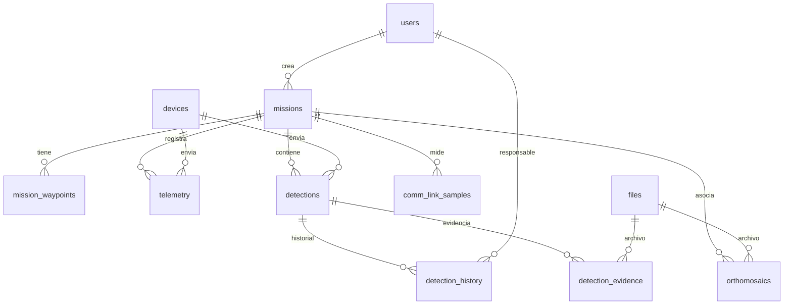

# Base de datos

PostgreSQL 16 + PostGIS 3.4. Migraciones con Alembic (`backend/alembic/versions`). Geometrías en SRID 4326, con índice GiST.

## Decisiones

- Posición solo en `geom`; la latitud y longitud se exponen en la API con `ST_Y/ST_X`. Un check garantiza rangos válidos.
- `telemetry` y `detections`: `UNIQUE(mission_id, event_id)`, `received_at` asignado por el servidor, `recorded_at/detected_at` por el VANT.
- `detections.footprint` (polígono) es opcional; `geom` (punto) siempre existe.
- `detection_history` registra cambios de `attention_status`, `validation_status` y `severity` con usuario y comentario.
- `files` es genérica (evidencia y ortomosaicos); los archivos no se guardan en tablas, solo `storage_key` y metadatos.
- `devices` almacena solo el hash de la API key.
- `comm_link_samples` respalda el experimento de confiabilidad del enlace (RSSI, SNR, pérdida, tasa de detección por distancia).
- Check constraints: batería 0–100, velocidad ≥ 0, confianza 0–1, área ≥ 0, `ended_at ≥ started_at`.

## Verificación realizada

`alembic upgrade head`, `downgrade base`, `upgrade head` y `alembic check` (sin diferencias entre modelos y migración) contra PostgreSQL 16 + PostGIS 3.4.
